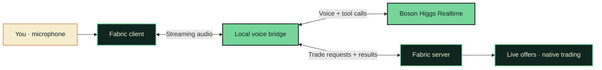

<p align="center">
  
</p>

<p align="center">
  <strong>Your favorite village has something to say.</strong><br />
  Villagers that talk, remember, and pass stories around.
</p>

<p align="center">
  <a href="docs/setup.md"><strong>Get started</strong></a> &nbsp;·&nbsp;
  <a href="demo.md">Demo &amp; presentation</a> &nbsp;·&nbsp;
  <a href="docs/architecture.md">Architecture</a> &nbsp;·&nbsp;
  <a href="backend/README.md">Voice bridge</a>
</p>

<p align="center">
  
  
  
  
</p>

---

## Less hrrm. More hello.

Villagers have professions, stock, and a place in your world. Now you can ask them about it.

**HIGGS HRRM** gives Minecraft villagers a voice through Boson Higgs Realtime. Walk up, start a conversation, ask what is available, and request a trade. The mod connects the conversation to live offers and opens Minecraft’s familiar trading screen.

<table>
  <tr>
    <td width="33%" valign="top">
      <h3>01 &nbsp; Meet</h3>
      <p>Look at a nearby villager and press <kbd>V</kbd>. Wait for <strong>Ready</strong>.</p>
    </td>
    <td width="33%" valign="top">
      <h3>02 &nbsp; Speak</h3>
      <p>Hold <kbd>B</kbd>, say what is on your mind, then release to hear the reply.</p>
    </td>
    <td width="33%" valign="top">
      <h3>03 &nbsp; Trade</h3>
      <p>Ask to open an available offer. Choose and confirm it in Minecraft.</p>
    </td>
  </tr>
</table>

## The conversation

Try these prompts with a villager. Responses are generated live; available items depend on its actual offers.

> **Say hello** &nbsp; “What do you do around here?”
>
> **Explore the shop** &nbsp; “What can I buy from you?”
>
> **Make a request** &nbsp; “Open the trade for…” — name an available item it mentioned.

The payoff is a real merchant screen opening from a spoken request. You select the offer and complete the exchange there.

## A voice with a connection to the world

| | What happens |
| :--- | :--- |
| **In-character conversation** | Villager name, profession, and level give the conversation context. |
| **A village that remembers** | Saved summaries let each villager recall past conversations across visits and server restarts. |
| **Stories that travel** | Nearby villagers pass along public stories; green particles signal a new rumour. |
| **Live offer lookup** | `get_trades` reads current offers from the Minecraft server. |
| **An action you can see** | `propose_trade` checks availability and proximity, then opens native trading. |
| **Room to interrupt** | Hold **B** during a reply to interrupt and begin your next turn. |
| **Player-controlled purchases** | Minecraft handles the exchange and final prices; voice does not spend your items. |

## The village remembers

Tell a villager, **“Remember this: I found emeralds under the old well.”** End the conversation and return to ask what it remembers. Its saved summaries survive visits and server restarts.

Keep another awake villager nearby. A brief burst of green particles signals that a new story has passed between them. Ask the neighbour, **“Heard any news about me?”** It can tell you what it heard and who told it.

Stories stay attributed as player claims. Explicitly private entries do not spread; ordinary stories can reach other players through village news. **[Try the memory and rumours demo →](docs/memory-rumours.md)**

## Under the hood



We build the mod, audio capture and playback, local bridge, session handling, and game tools. Higgs powers voice and tool-call generation. Minecraft owns the offers, inventory, and actual transaction.

## Bring your village to life

You will need **Minecraft Java 26.1.2**, a matching **Fabric client**, **JDK 25**, **Node.js 22+**, and a **Boson API key**. Install the mod on both client and server. The bridge runs locally alongside the game server.

**[Follow the complete setup guide →](docs/setup.md)**

Already have the local installation configured? Start the bridge and server in separate terminals:

```sh
npm --prefix backend start
```

```sh
./server-cardboard/start.command
```

Join `localhost:25565`, face an adult, awake villager within eight blocks, and press **V**. [Installation, credentials, microphone permission, and troubleshooting](docs/setup.md#villager-voice-prototype) are covered in the setup guide.

| Key | Action |
| :--- | :--- |
| **V** | Start or end a conversation |
| **Hold B → release** | Speak, then send your turn |
| **F8** | Show or hide voice diagnostics |

## On the workbench

This is a hackathon prototype. The voice bridge, Fabric integration, and trade tools are implemented. Full microphone, playback, and in-game trade validation still need confirmation on the target setup; local mock tests and synthetic voice probes cover only part of that path.

Current scope includes push-to-talk, system audio for the speaking player, persistent conversation summaries, and local rumour spreading with a particle indicator. Memory and gossip have local regression coverage; live voice recall and particle visibility still need in-game validation. Distinct saved personalities, negotiated prices, and spatial or shared audio are future directions.

<details>
<summary><strong>Development checks</strong></summary>

```sh
npm --prefix backend test
./scripts/build-mod.sh
```

Backend tests use a local fake Higgs endpoint. The build compiles the mod; neither check establishes a successful live conversation. See the [bridge notes](backend/README.md) for investigation evidence.

</details>

## Explore the project

| Path | Inside |
| :--- | :--- |
| [`mod/`](mod/) | Fabric client and server; microphone, playback, sessions, and trades |
| [`backend/`](backend/) | Local Higgs voice bridge and tool routing |
| [`docs/architecture.md`](docs/architecture.md) | System boundaries and the end-to-end interaction |
| [`docs/setup.md`](docs/setup.md) | Full installation, controls, local server, and troubleshooting |
| [`docs/memory-rumours.md`](docs/memory-rumours.md) | Persistent memory, nearby gossip, demo prompts, and settings |
| [`demo.md`](demo.md) | Presentation script, demo flow, and rehearsal checklist |
| [`docs/brand.md`](docs/brand.md) | Logo, colors, and artwork notes |

---

<p align="center">
  <br />
  <strong>Give the hrrm a voice.</strong><br />
  <sub>Built with Fabric · Powered by Boson Higgs Realtime</sub><br />
  <sub>Unofficial Minecraft project. Banner artwork is illustrative, not a gameplay screenshot.</sub>
</p>
