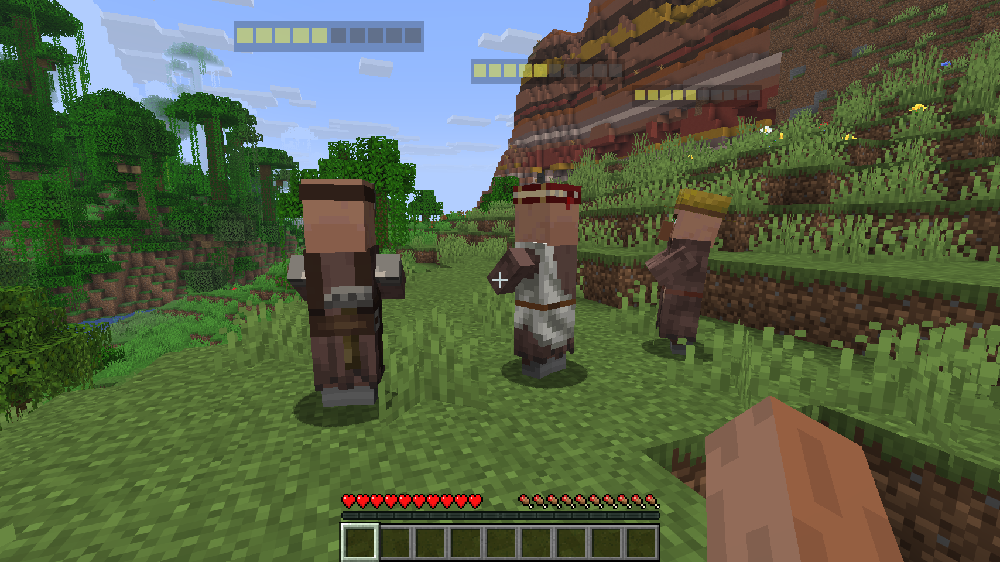
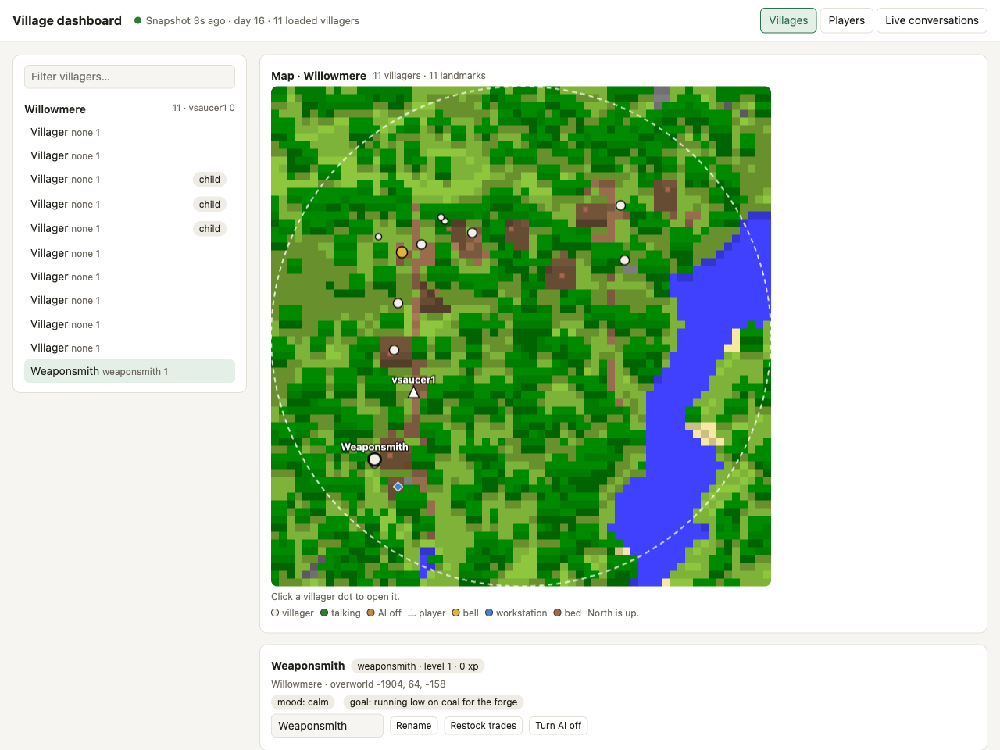
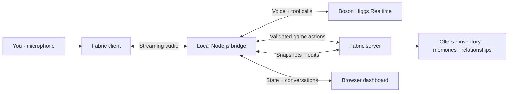

<p align="center">
  
</p>

<p align="center">
  <strong>Your favorite village has something to say.</strong><br />
  Villagers that talk, remember, and pass stories around.
</p>

<p align="center">
  <a href="docs/setup.md"><strong>Get started</strong></a> &nbsp;·&nbsp;
  <a href="https://www.youtube.com/watch?v=D5wlctYf8L4">Watch the demo</a> &nbsp;·&nbsp;
  <a href="docs/architecture.md">Architecture</a> &nbsp;·&nbsp;
  <a href="backend/README.md">Voice bridge</a>
</p>

<p align="center">
  
  
  
  
</p>

---

## Less hrrm. More hello.

**HIGGS HRRM** gives Minecraft villagers a voice, a memory, and relationships that grow through play. Talk naturally, negotiate real trades, share news, give gifts, and ask a neighbour to show you around. A **live browser dashboard** makes the village's state visible for demos, debugging, and tuning.

## BosonAI API usage — how we use the model

**Boson Higgs is the conversational engine behind each villager.** It turns a player's speech and the villager's current context into an expressive spoken response and requests for game actions.

| Where we use Boson | What it adds to the experience |
| :--- | :--- |
| **Live voice conversations** | The bridge streams microphone audio to Higgs Realtime and streams the villager's voice back into Minecraft. Personality, delivery style, and interruptions make each encounter feel distinct. |
| **Actions grounded in the game** | The model requests tools to look up offers, propose trades, remember stories, give quests, or guide a player. The Minecraft server validates and executes those requests. Prices, stock, inventory, and purchases remain controlled by game rules; a trade requires a fresh spoken confirmation. |
| **Memory and relationships** | The model selects meaningful stories and judges their relevance for gossip. After a conversation with at least two player turns, a separate text-only call writes a short digest, relationship summary, and promises for future visits. |
| **A village that reacts** | Additional voice sessions power nearby chatter, a second conversation partner, and reactions to events such as danger, gifts, music, and the village bell. |

The main conversation uses **`higgs-realtime-1.5-preview`**, with **`higgs-stt-3.1`** for player transcription. Memory consolidation uses **`higgs-realtime`** in text-only mode. The Node.js bridge authenticates with `BOSON_API_KEY` over Boson's realtime WebSocket API; the key stays in the backend. Audio, relevant game context, and selected memories are sent to Boson to generate responses.

**Usage grows with conversations and ambient activity.** A companion adds a second session; chatter opens sessions for its participants; memory consolidation adds one short text-only session after qualifying conversations. Set `HIGGS_COMPANION_ENABLED=false`, `HIGGS_CHATTER_ENABLED=false`, or `HIGGS_CONSOLIDATION_ENABLED=false` to disable those extras. There is no fixed cost estimate here; usage depends on the demo and your Boson account. [Integration details](backend/README.md) · [Session configuration](backend/lib/protocol.js)

## See it in action

**[Watch the HIGGS HRRM demo on YouTube](https://www.youtube.com/watch?v=D5wlctYf8L4).**



*Actual Minecraft capture from the local demo, with profession-specific villagers and reputation bars.*



*Willowmere, captured from the running server: a live terrain map with villagers, the player, bell, workstations, and beds. Selecting the weaponsmith reveals its details and controls below the map.*

## What you can do

| Experience | Current behavior |
| :--- | :--- |
| **Talk and interrupt** | Look at an awake adult villager, hold **B** to talk, and release to send. Replies use positional audio and appear in chat. Nearby villagers can join, answer by name, and hand over a trading conversation. |
| **Trade by voice** | Browse real offers, request quantities or a budget, haggle, and confirm a purchase. Reputation affects prices; quests can unlock a better deal. An on-screen quote and receipt track the exchange. |
| **Build a relationship** | Give gifts, keep promises, complete quests and errands, and earn friendship, nicknames, daily presents, and a keepsake book. Mistreatment can lead to refusals and hostility. |
| **Leave a lasting memory** | Villagers retain summaries and a journal of shared events. Public stories spread through nearby gossip and overheard chatter; explicitly private memories do not spread. |
| **Explore together** | Ask for a walk, directions to a neighbour or workplace, or rumours of real landmarks beyond the village. Friendly villagers can escort you when conditions allow. |
| **Bring the village to life** | Named villages, distinct personalities, expressive gestures, bedtime, danger cries, jukebox dancing and raps, bell gatherings, fireworks, children's games, and pet remarks add reactions to the world. |
| **Inspect and tune** | Use the dashboard to inspect villagers, players, live conversations, memories, trades, and relationships, and apply supported edits. |

Try **“What can I buy from you?”**, **“I found a hidden library under the old well”**, **“Anything I can help with?”**, or **“Show me the librarian.”** The game state determines what can happen.

[Full gameplay reference](docs/gameplay.md) · [Memory and rumours demo](docs/memory-rumours.md) · [Meet the personalities](docs/villager-personalities.md)

## Village dashboard

The dashboard ships with the voice bridge: **no separate frontend build or server is needed**.

- **Villages and villagers:** loaded villagers grouped by village, player reputation, and a top-down terrain map when a real village's chunks are loaded. Select a villager to inspect profession, personality, mood, trades, stock, memories, rumours, and relationships.
- **Players:** online players, active conversations, open quotes, walks, errands, quests, earned deals, and nearby villagers.
- **Live conversations:** transcripts and the exact session context supplied to Boson, useful for explaining why a villager responded as it did.
- **Edits:** rename villagers, restock trades, toggle AI, adjust standing or nicknames, manage quests and errands, forget a journal episode, or reset a relationship. Edits affect the running world.

The game server syncs every **3 seconds**, builds full snapshots only while the dashboard is being watched, and applies edits on the next sync. Only loaded villagers appear. Visit a generated village to populate its map; a group of spawned demo villagers outside a village still appears in the list. Maps refresh roughly once a minute. **AI off** refers to Minecraft movement AI, as used by stationary demo villagers.

To enable it, set `HIGGS_DASHBOARD_TOKEN` in the root `.env` to a random token of at least 16 characters and restart the bridge. Generate a token with:

```sh
openssl rand -hex 16
```

Open `http://localhost:8787/dashboard?token=YOUR_DASHBOARD_TOKEN`, replacing the placeholder with your local token. The page removes the token from the address bar and keeps it in that tab's session storage. Access is restricted to local connections. Set `HIGGS_DASHBOARD_OPEN=false` if you prefer to open it manually instead of at bridge startup. Join the game so the server is awake and villagers are loaded.

## Run Minecraft and the dashboard

You need a licensed **Minecraft Java 26.1.2** client, **Fabric Loader 0.20.1**, **JDK 25**, **Node.js 22+**, and a **Boson API key**. Install Higgs Villagers and Fabric API on both client and server. This repository's server setup also uses Cardboard and iCommon; those belong on the server only.

### 1. Configure the bridge

From the repository root, create `.env` on first setup (keep an existing file):

```sh
cp -n .env.example .env
npm --prefix backend ci
openssl rand -hex 32
openssl rand -hex 16
```

Edit `.env` and set:

```dotenv
BOSON_API_KEY=YOUR_BOSON_API_KEY
HIGGS_BRIDGE_TOKEN=YOUR_FIRST_GENERATED_TOKEN
HIGGS_DASHBOARD_TOKEN=YOUR_SECOND_GENERATED_TOKEN
HIGGS_HOST=127.0.0.1
HIGGS_PORT=8787
HIGGS_DASHBOARD_OPEN=true
```

The game server and bridge must read the same `HIGGS_BRIDGE_TOKEN`; the local server reads the project `.env`. Keep credentials out of Git. Restart the bridge after changing its settings, and the game server after changing server-side settings.

To register the project's shared voices with your Boson account:

```sh
npm --prefix backend run setup:voices
```

Voice registration calls Boson and may incur usage. [Voice setup details](shared/voices/README.md)

### 2. Install the mod and provision the server

For a **fresh clone**, follow the [complete setup guide](docs/setup.md) for server downloads, checksums, client dependencies, and Minecraft EULA acceptance. Worlds, server JARs, Java, and credentials are not included in the repository.

On Linux, the setup script downloads the pinned server dependencies, builds the mod, and installs it into the supplied client mods folder:

```sh
./scripts/setup-linux.sh /absolute/path/to/your/instance/.minecraft/mods
```

For an **already provisioned installation**, rebuild and copy the mod with Minecraft and the server stopped:

```sh
./scripts/build-mod.sh
cp mod/build/libs/higgs-villagers-0.1.0.jar server-cardboard/mods/
cp mod/build/libs/higgs-villagers-0.1.0.jar /absolute/path/to/your/instance/.minecraft/mods/
```

Use the same built JAR on both sides. For animated faces, install the pinned client-only visual dependencies using the [villager visuals guide](docs/villager-visuals.md). [Linux / CachyOS walkthrough](docs/linux.md)

### 3. Start both services

Terminal 1 — voice bridge and dashboard:

```sh
npm --prefix backend start
```

Terminal 2 — provisioned Minecraft server:

```sh
./server-cardboard/start.command
```

Launch the configured Fabric client in Prism or your Minecraft launcher, then choose **Multiplayer → Direct Connection → `localhost:25565`**. Use the dashboard URL above; it also opens automatically unless disabled. If the server whitelist is enabled, add your account from the server console as described in the setup guide.

Face an awake adult villager within eight blocks and wait for **Ready**. Hold **B**, speak, and release. Ask for an available item, listen to the exact quote, then say **yes** in a new turn. Allow microphone access for the Minecraft/Java process when prompted. Type `stop` in the server console to save and shut down cleanly; stop the bridge with Ctrl+C.

| Control | Action |
| :--- | :--- |
| **Look at a villager** | Connect automatically; press B to interrupt gossip or switch to another villager |
| **Hold B → release** | Speak and send; pressing B during a reply interrupts it |
| **T** | Scroll conversation captions in Minecraft chat |
| **F6 / F7 / F8 / F9** | Inspect session / model context / audio / quests and relationships |
| **PgUp / PgDn** | Scroll the open debug page |

**No dashboard data?** Join the server, load nearby villagers, and wait a few seconds. An empty server may be paused. **Dashboard disabled?** Set a token of at least 16 characters and restart the backend. **No voice?** Check the Boson key, shared bridge token, microphone permission, and F8 diagnostics. [Full troubleshooting](docs/setup.md)

## Under the hood



The mod owns game state, persistence, microphone capture, and playback. The bridge manages Boson sessions, tool routing, and the dashboard. Boson generates dialogue and tool requests; Minecraft decides which actions succeed. [Architecture](docs/architecture.md)

## Development and validation

This is a hackathon prototype. The screenshots above show the running Minecraft client and live dashboard; they do not establish that every voice interaction or gameplay feature has been playtested.

```sh
npm --prefix backend test
./scripts/build-mod.sh
```

Backend tests use a local fake Higgs endpoint. The build compiles the mod; live API access, microphone behavior, and end-to-end gameplay require the [playtest checklist](docs/playtest-checklist.md). Watch the [recorded demo](https://www.youtube.com/watch?v=D5wlctYf8L4) for the project walkthrough.

## Explore the project

| Path | Inside |
| :--- | :--- |
| [`mod/`](mod/) | Fabric client and server, gameplay, audio, and persistence |
| [`backend/`](backend/) | Boson voice bridge, session coordination, tools, and dashboard |
| [`backend/public/dashboard.html`](backend/public/dashboard.html) | Browser dashboard UI |
| [`docs/setup.md`](docs/setup.md) | Installation, credentials, checksums, and troubleshooting |
| [`docs/gameplay.md`](docs/gameplay.md) | Detailed feature behavior and limits |
| [`docs/memory-rumours.md`](docs/memory-rumours.md) | Persistent memory and gossip demo |
| [`docs/assets/screenshots/`](docs/assets/screenshots/) | Actual Minecraft and dashboard captures |

---

<p align="center">
  <br />
  <strong>Give the hrrm a voice.</strong><br />
  <sub>Built with Fabric · Powered by Boson Higgs Realtime</sub><br />
  <sub>Unofficial Minecraft project. The top banner is illustrative; the screenshots show the running prototype.</sub>
</p>
