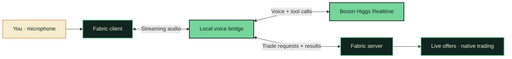

<p align="center">
  
</p>

<p align="center">
  <strong>Your favorite village has something to say.</strong><br />
  Villagers that talk, remember, and pass stories around.
</p>

<p align="center">
  <a href="docs/setup.md"><strong>Get started</strong></a> &nbsp;·&nbsp;
  <a href="demo.md">Demo &amp; presentation</a> &nbsp;·&nbsp;
  <a href="docs/architecture.md">Architecture</a> &nbsp;·&nbsp;
  <a href="backend/README.md">Voice bridge</a>
</p>

<p align="center">
  
  
  
  
</p>

---

## Less hrrm. More hello.

Villagers have professions, stock, and a place in your world. Now you can ask them about it.

**HIGGS HRRM** gives Minecraft villagers a voice through Boson Higgs Realtime. Walk up, start a conversation, ask what is available, and request a trade. The mod connects the conversation to live offers and completes a native trade after one spoken confirmation.

<table>
  <tr>
    <td width="33%" valign="top">
      <h3>01 &nbsp; Meet</h3>
      <p>Look at a nearby villager to connect automatically. Let it greet you.</p>
    </td>
    <td width="33%" valign="top">
      <h3>02 &nbsp; Speak</h3>
      <p>Hold <kbd>B</kbd>, say what is on your mind, then release to hear the reply.</p>
    </td>
    <td width="33%" valign="top">
      <h3>03 &nbsp; Trade</h3>
      <p>Ask for an available offer. Hear the quote and say yes to confirm.</p>
    </td>
  </tr>
</table>

## The conversation

Try these prompts with a villager. Responses are generated live; available items depend on its actual offers.

> **Say hello** &nbsp; “What do you do around here?”
>
> **Explore the shop** &nbsp; “What can I buy from you?”
>
> **Make a request** &nbsp; “I would like…” — name an available item it mentioned.

The villager reads the exact quote. Say yes in a new push-to-talk turn to complete one trade, without opening a screen.

## A voice with a connection to the world

| | What happens |
| :--- | :--- |
| **A village of characters** | Saved identities, voices and delivery styles make Mira, Rowan and Bram respond differently. Jobs and name tags preserve their character. |
| **A village that remembers** | Saved summaries let each villager recall past conversations across visits and server restarts. |
| **Stories worth repeating** | The voice model judges surprising or consequential stories; neighbours prioritise news relevant to their professions. |
| **A neighbour with something to say** | Start a conversation and the villager can lead with a fresh rumour, without a special question. |
| **Live offer lookup** | `get_trades` reads current offers from the Minecraft server. |
| **An action you can see** | `propose_trade` quotes an exact bundle; `confirm_trade` performs one validated purchase after a fresh spoken yes. |
| **Room to interrupt** | Hold **B** during a reply to interrupt and begin your next turn. |
| **Player-controlled purchases** | You approve the exact quote by voice; Minecraft validates stock, payment, and inventory before the exchange. |

## The village remembers

Casually tell a villager, **“I found a hidden library under the old well.”** It decides whether that is useful personal information or a story the village would find surprising. You do not need to ask it to remember. Saved summaries survive visits and server restarts.

Keep another awake villager nearby. A brief burst of green particles signals that news has passed between them. Look at the neighbour and tap **B** to switch, then let it speak first: it can open with a fresh rumour and credit its source. A librarian gives extra attention to the library discovery; routine preferences can stay personal memories. Freshness, relevance, and recent-topic tracking guide what comes up.

Stories stay attributed as player claims. Explicitly private entries do not spread; ordinary stories can reach other players through village news. **[Try the memory and rumours demo →](docs/memory-rumours.md)**

## One village, different minds

**Mira** is generous, warm and nosy. **Rowan** demands evidence but hopes for a mystery. **Bram** is guarded, practical and quietly fond of poetry. Tell them the same story and discover their different perspectives through conversation. **Rook** adds a mildly aggressive edge: impatient, protective and quick with a dry challenge. Their discretion also changes when they pass news along.

Villagers keep their identities across visits and restarts. Confirmed return visits build bounded familiarity. **[Meet the cast and prepare the demo →](docs/villager-personalities.md)**

## Under the hood



We build the mod, audio capture and playback, local bridge, session handling, and game tools. Higgs powers voice and tool-call generation. Minecraft owns the offers, inventory, and actual transaction.

## Bring your village to life

You will need **Minecraft Java 26.1.2**, a matching **Fabric client**, **JDK 25**, **Node.js 22+**, and a **Boson API key**. Install the mod on both client and server. The bridge runs locally alongside the game server.

**[Follow the complete setup guide →](docs/setup.md)** · **[Linux / CachyOS from scratch →](docs/linux.md)**

Already have the local installation configured? Start the bridge and server in separate terminals:

```sh
npm --prefix backend start
```

```sh
./server-cardboard/start.command
```

Join `localhost:25565`, face an adult, awake villager within eight blocks, and wait for the automatic voice connection. [Installation, credentials, microphone permission, and troubleshooting](docs/setup.md#villager-voice-prototype) are covered in the setup guide.

| Key | Action |
| :--- | :--- |
| **Look at a villager** | Connect automatically; look at another and press B to switch |
| **Hold B → release** | Speak, then send your turn |
| **F6** | Debug: conversation / Boson session (state, tool calls, provider events) |
| **F7** | Debug: context sent to Boson (personality, rumours, memories, offers) |
| **F8** | Debug: audio & connection (devices, mic level, queues, status history) |
| **F9** | Debug: your quests, earned deals, errand, open quote, walk, and how each villager you know regards you (standing, stage, nickname, open promises) |
| **PgUp / PgDn** | Scroll the open debug page |

## On the workbench

This is a hackathon prototype. The voice bridge, Fabric integration, and trade tools are implemented. Full microphone, playback, and in-game trade validation still need confirmation on the target setup; local mock tests and synthetic voice probes cover only part of that path.

Current scope includes push-to-talk, positional voice audio for the speaking player, persistent conversation summaries, automatic story selection, and local gossip with a particle indicator. Voice-confirmed trading, reputation-based prices, relationship scores, captions, automatic targeting, and hit reactions are also implemented. Memory and gossip have local regression coverage; live story judgments, recall, and particle visibility still need in-game validation. Distinct saved personalities, per-character voices, familiarity and different gossip habits are implemented with local regression coverage. Live voice auditions and the three-character demo still need rehearsal; shared audio remains a future direction.

<details>
<summary><strong>Development checks</strong></summary>

```sh
npm --prefix backend test
./scripts/build-mod.sh
```

Backend tests use a local fake Higgs endpoint. The build compiles the mod; neither check establishes a successful live conversation. See the [bridge notes](backend/README.md) for investigation evidence.

</details>

## Explore the project

| Path | Inside |
| :--- | :--- |
| [`mod/`](mod/) | Fabric client and server; microphone, playback, sessions, and trades |
| [`backend/`](backend/) | Local Higgs voice bridge and tool routing |
| [`docs/architecture.md`](docs/architecture.md) | System boundaries and the end-to-end interaction |
| [`docs/setup.md`](docs/setup.md) | Full installation, controls, local server, and troubleshooting |
| [`docs/memory-rumours.md`](docs/memory-rumours.md) | Persistent memory, nearby gossip, demo prompts, and settings |
| [`demo.md`](demo.md) | Presentation script, demo flow, and rehearsal checklist |
| [`docs/brand.md`](docs/brand.md) | Logo, colors, and artwork notes |

---

<p align="center">
  <br />
  <strong>Give the hrrm a voice.</strong><br />
  <sub>Built with Fabric · Powered by Boson Higgs Realtime</sub><br />
  <sub>Unofficial Minecraft project. Banner artwork is illustrative, not a gameplay screenshot.</sub>
</p>

Each finished turn from you and the villager is added to Minecraft chat, so the conversation stacks up and can be scrolled back with T. Your transcript arrives after speech processing. The microphone HUD stays visible during conversations; F6, F7, F8 and F9 toggle the debug pages.

Successful voice trades show a gentle handoff: cosmetic payment items float toward the villager, then the purchased item floats back. A soft chime and a fading receipt confirm the exchange. These client-only copies never become dropped items or affect inventory.

## Long-term memory

Villagers remember what actually happened between you, not only what you told them:
trades (with what you paid), gifts and refused gifts, quests set and finished, errands,
hits, kind or rude words, and the day you first met. Villagers nearby who saw you hit,
gift or trade with a neighbour remember that too. Each conversation starts with this
history, and a villager may bring up one shared moment naturally (“still happy with
those axes?”); asking “what did I buy last time?” finds it. Routine events fade after 30
real days, important ones (quests, first meetings) last up to four times longer, and
things you told villagers now last 30 days. Saved in `data/higgs-journal.json`.

After each real conversation, the villager also folds it into memory in its own words:
a short digest of what mattered, any promises (“you said you'd deal with the wolves”),
and a running summary of your whole relationship that never expires. This uses one
short text-only Boson call per conversation; turn it off with
`HIGGS_CONSOLIDATION_ENABLED=false` in `.env`.

## Gifts

Hand a villager a gift by voice (“I brought you a diamond… here you go”) or by sneaking
and using an item on it. By voice, the server takes the item you named from your hands
or inventory (with a count, if you said one); a sneak-use gives one of the held item.
Every villager has fixed tastes, derived from its identity and profession: two loved
items (one from its trade, such as books for a librarian, and one treat) and two it
refuses. A gift card appears in the trade tracker showing what you gave and how it landed.

| Gift | Result |
| --- | --- |
| Loved | +3 reputation, hearts |
| Precious (diamond, emerald, gold, enchanted book, golden apple…) | +2 reputation |
| Nice food, flowers or useful materials | +1 reputation |
| Anything else | Accepted politely, no reputation |
| Disliked | Handed back and remembered; offering it again costs 1 reputation |

Reputation from gifts counts at most once every five minutes per villager, and gifts
never make a villager hostile; a loved gift lifts a hostile villager straight back to
trading terms. A villager you are talking to reacts out loud, knows its own tastes, and
remembers what you gave and what it refused (saved in `data/higgs-gifts.json`). Ask
what it likes. A villager that says it took a gift without actually receiving one is
corrected, like an invented trade.

## Three-way conversations

When you start talking to a villager, the nearest idle neighbour within four blocks (one
that is not hostile to you) joins in, outlined alongside your partner and turned to face
you. It hears everything, and now and then adds a short remark of its own after your
partner speaks: agreeing, teasing, or gossiping about you from its own opinion. Say its
name (“Bram, what do you think?”) and it answers instead. The neighbour has its own
personality and voice and speaks from where it stands, never over your partner, but it
never trades, takes gifts, or hands out quests or errands; talk to it directly for that.
Its lines appear in chat under its name.

Villagers who wander within four blocks of you or your partner mid-conversation may join
too (a one-in-five chance every two seconds while nobody else has joined): they catch up
on the last few lines and greet you or react to what was said. Ask a companion to leave
(“Bram, could you give us a moment?”, “leave us alone, please”): one who likes you always
says goodbye and walks off; a neutral one goes half the time, and an annoyed one usually
stays to listen, with a nosy or pointed reply. One that leaves will not rejoin you for two
minutes. Each three-way conversation uses a second Boson session; set
`HIGGS_COMPANION_ENABLED=false` in `.env` to turn it off.

## Night and danger

From dusk until dawn (in-game 12500–23500) villagers
want to go to bed: try to talk to one and it says a short goodnight in character, then
the conversation ends once the line has played. For the next 90 seconds it just shows
“heading to bed” instead of starting another conversation. Chatter and companions also
stop for the night. Hitting a villager still gets a reaction.

A villager being chased by a zombie (any zombie hunting it within 8 blocks, including
husks, drowned and zombie villagers) screams for help in its own voice, every 8–14
seconds while the chase lasts; players within earshot hear it from the villager, with a
caption. Screams are cached per voice (three variants), so after the first few they cost
no extra Boson usage and play at once.

## Music and the bell

Play a record in a jukebox and villagers within 12 blocks dance: they spin, nod, hop and
give off music notes. Soon after the music starts, one of them breaks into a short rap
about its trade in its own voice (a fresh verse each time; at most one per jukebox every
90 seconds). Ring a village bell and, instead of everyone hiding, up to three villagers
nearby walk over and ask who rang it and what the matter is. Villagers with AI disabled
only answer if they are already within six blocks.

## Fireworks, children and pets

Launch a firework near villagers and they look up at the sky; one of them “ooh”s, and
the ones who like you clap (a happy hop and sparkles). By day, village children near you
pair up for games of tag: one chases, the other runs, and each tag swaps them with a
giggle. At dusk an adult calls the children home and they run to it. When your tamed
wolf, cat or parrot wanders up to a villager, it remarks on it in its own voice, using the
pet's name if you gave it one; about one villager in four is nervous of wolves, asks you
to keep it back and steps away. Pet remarks come at most every 30 seconds, and each
villager comments at most every five minutes.

## Walking together

Ask a villager to walk with you (“come for a walk with me”) and, unless it dislikes you,
it's dark, or something is chasing it, it follows you while you keep talking. Along the
way it mentions who and what you pass, calls out if you run ahead, and when you reach the
edge of its village, nightfall, or danger, it says so and heads home. Say “you can go
home” to end the walk; ending the conversation does too. Villagers with AI disabled (like
demo villagers) get it back for the walk and are returned to their exact spot, with AI
off again, afterwards. The walk becomes a memory (“I walked with Steve through Kettleby,
past Iris the librarian”).

## Directions

Ask a villager for directions (“where's the librarian?”, “take me to Iris”, “show me the
bell”, “which way to the library?”) and it leads you there, within its village: to a
villager by name or trade (any smith for “a smith”), to the village bell, or to a trade's
workplace. It talks as you walk, waits and calls “this way!” if you fall behind, and if it
loses the way it apologises and tells you where to go instead. At a landmark it says
you've arrived. At a villager it introduces you: your conversation moves to the new
villager, who greets you and thanks your guide, and the guide stays with you as a
companion until it leaves or the conversation ends, then walks home. Both remember it
(“I showed Steve the way to Iris”, “Bram brought Steve to meet me”).

Villagers also know of places beyond the village by rumour: “where's the nearest forest?”,
“is there a pyramid around here?”, “have you heard of any hidden chests?”, “which way to
the sea?”, “is there another village?”. The server finds the nearest real one (a biome
within about 1,000 blocks, or a structure such as a desert or jungle temple, buried treasure,
a shipwreck, an ocean monument, a mansion, an outpost, a ruined portal or another village).
It never makes one up.

- **Directions:** usually the villager tells you where to look as something it heard, with
  a rough direction and distance. A grey chat note keeps it for you (“Rumour from Iris: a
  desert temple, about 400 blocks north-west of Kettleby”).
- **Escort:** a villager that counts you as a friend or closer walks you there if it's
  within about 320 blocks, chatting on the way. It points the place out, wishes you luck and
  heads back to the village. Out of anyone's sight, it's set down back home (its home chunk
  is loaded first).
- **Turning back:** nightfall or a zombie sends it home early.

## Growing closer

Each villager keeps track of how close you've grown, from what it has seen: conversations,
trades, gifts, quests, errands, walks, and kept promises count for you; hits, insults and
broken promises count against you. Five stages: stranger, acquaintance, friend, close
friend, confidant. Each also needs goodwill, so a villager who dislikes you stays an
acquaintance. The stage sets its warmth without ever being named aloud.

- **Milestones:** the first time you reach friend, close friend, or confidant, the action
  bar says so (“Bram now considers you a friend”), with hearts and a cheer. It becomes a
  memory (“Today Steve and I became friends”). If you're talking, the villager warms up
  then and there. A stage once reached is kept, even as old memories fade.
- **Nickname:** a close friend picks a fond nickname for you once, keeps it, and greets you
  by it.
- **Promises:** promises either of you made stay open. The villager asks how one is going
  when it fits. When a later conversation shows you kept it, standing rises by 1 and it
  remembers (“A promise was kept: …”). A broken one costs 1.
- **Daily present:** once per in-game day, a confidant greets you with something from its
  own wares and mentions it.
- **Keepsake:** on reaching confidant, or when a close friend is asked to “write down our
  story”, the villager gives you a signed book, *Our story*. It holds the relationship
  summary, the milestones with their days, and up to eight notable shared moments, all
  written from its journal. One per villager.

Stages, nicknames, promises and the keepsake flag live in `world/data/higgs-journal.json`
(schema 2; older saves load as before).

## Errands

Ask a villager for work (“anything I can help with?”) and it may send you to a neighbour
in the same village: either to pass on a short message it writes (“Tell Bram the wolves
are back”) or to deliver a package from its wares, which it hands you. The recipient
glows for two minutes, and an **ERRAND** card shows what you carry, who it is for, and
roughly where they are (“30 blocks north-east”). You also get a book and quill titled
“Errand: Iris → Bram” recording who sent you, who it is for, the exact message or
package, where the recipient was, and the reward. Talk to the recipient and pass it on in your
own words. It knows nothing in advance and learns the message only from you; the server
checks that what you said carries the gist (or takes the package) and gains 1 reputation, and the villager who
sent you gains 2 and remembers the favour. One errand at a time; it lapses after two
hours. Hostile villagers do not hand out errands, so errands are a good way to rebuild
a damaged reputation. Saved in `data/higgs-errands.json`.

## Villagers who dislike you

A villager who dislikes you may refuse to talk: a 25% chance at -2, rising to 75% when
hostile. It says no, turns its back and walks off (villagers with AI disabled can only
turn away), and keeps refusing for 30 seconds. Hitting it still gets a reaction.

## Villages

Every generated village gets a name the first time a player comes near it, picked at
random from 20 names in `mod/src/main/resources/higgs_villagers/village_names.txt`
and saved with the world (`data/higgs-villages.json`). Walking within 64 blocks of a
village's centre shows its name as a title, with your village reputation underneath:
the average of how every villager in that radius regards you (villagers you have never
met count as neutral), for example “Reputation: Friendly (+1.6)”. Villagers know their
village's name and its overall opinion of you. Change the radius with
`HIGGS_VILLAGE_RADIUS` in `.env`.

## Overheard chatter

Villagers sometimes talk to each other. Every minute or so (half the time), two idle
adult villagers standing within six blocks of each other and within earshot of a player
strike up a four-to-six line conversation, each in their own personality and voice.
They gossip about the nearby player (their opinion of you, whether you hit them
recently, and public things you told them), talk shop about their trade, chat about the
weather and time of day, or pass on a public rumour. Private memories never reach
chatter. When they talk about you, a villager with a clear opinion (friendly, or annoyed
and worse) praises or badmouths you to the other, moving that villager's opinion one
point toward its own: never past it, and never into hostility, which only your own
actions cause. You see hearts or angry particles and a note such as “Bram spoke well of
you to Iris”. Sometimes a third neighbour standing with both joins in. Villagers have fixed bonds with
one another (siblings, good friends, rivals or acquaintances) and a state of mind (a
mood from what happened to them today, a goal from their trade, and what's on their
mind), which colour the talk: a villager you hit stays shaken and suspicious while a
friend you gave a diamond defends you. Whoever is addressed by name answers next, and a
scene ends early on a goodbye. A line that only echoes another is never heard: the
villager gets one fresh try. What they say about you becomes each villager's memory
(“When we talked about you, Alden said you hit him”). Each line plays from the speaking villager, fading with distance (16 blocks),
and appears in chat as a grey, italic caption. Starting your own conversation, or
talking to either villager, stops the scene. Each villager chats at most once every
five minutes, and one scene runs at a time.

Chatter uses two Boson realtime sessions per scene. Tune or disable it with the
`HIGGS_CHATTER_*` settings in `.env` (see `.env.example`), then restart the game server.

Before a demo, run through the [playtest checklist](docs/playtest-checklist.md).

## Voice trading

Villagers know before speaking whether they have anything to sell and what is in stock.
One with no profession, a nitwit, or one sold out of everything gets no trading tools at
all and says so instead of inventing wares. The **Hero of the Village** effect applies
vanilla's discount (30%, plus 6.25% per extra level) to voice quotes and haggling floors
alike, and the villager thanks you for saving the village.

Ask for an item, a quantity, or a budget: “I would like fifteen bread” or “How much
bread can I buy with four emeralds?” The server quotes exact whole-item amounts,
opening at the villager's normal price; say yes in a new turn to buy. A changed
bundle always needs a fresh yes.

Each villager keeps one reputation score towards you, from -5 to +5, starting at 0
(the middle of the bar above its head). A compliment adds 1; a hit or insult takes 2.
The lowest price a villager accepts is `100 − 5 × score` percent of the base price:
+5 is 75%, 0 is 100%, and -5 is 125%, with payments rounded to whole items and never
below 1. Quotes open at the normal price, or the marked-up price when the villager
dislikes you. A villager who likes you can be haggled down: ask for a better price,
or name one (“Would you take 27 sticks?”). Any offer at or above its floor is
accepted as stated; a lower offer gets the villager's best price as a counteroffer.
Neutral and annoyed villagers hold firm. At -5 a villager turns hostile: it refuses
every voice trade and the vanilla trading screen, speaks coldly, and nearby iron golems
attack you as if you had hit them (player-built golems still never attack players, as in
vanilla). One sincere compliment or apology lifts it back to -4. Reputation
changes cancel any open quote; ask again for the current price. Vanilla Minecraft
reputation does not affect these voice quotes. Scores persist per player and
villager in the world data folder. Higgs classifies the utterance, while the server
decides every price and enforces every limit. Quotes expire after two minutes.

**Quests.** When your offer is below what a villager will accept (but at least 40% of
its normal price), a villager who isn't annoyed with you may set a quest instead of
countering: “Bring me a pillager banner first, then I'll take two emeralds for the
axe.” The server offers profession-themed errands, harder for a bigger discount (coal or
wheat for a small one, iron or gold for a fair one, an ominous banner or diamonds for a
steep one), and the villager picks one. Tell the villager when you have the items: the
server checks your inventory, takes them, and opens the deal at your price for one
purchase, confirmed with a yes as usual. Setting a quest also hands you a book and quill
(“Quest: Iris”) noting what to bring, the deal it unlocks, and where the villager was. Each villager keeps one open quest per player,
saved with the world (`data/higgs-quests.json`) and remembered in later conversations.
If the trade changes or sells out, the delivered quest waits for it to restock.

Bundles are limited to one stack per item (at most 64); secondary payments scale
proportionally, rounding up to whole items. A budget buys the most items it can
afford at or above the villager's floor, never paying more than the normal price, within stack and stock limits. Larger quantities
consume proportional stock, rounded up to native trade uses; small purchases
still use one stock unit. The native inventory transaction handles item
components, space, trade statistics and rewards. Every purchase checks payment,
stock, proximity and inventory space.

A compact, non-interactive trade tracker shows the villager and the current server quote: YOU GIVE, YOU GET, and “Say yes to accept.” Revised amounts briefly show the previous deal crossed out. Expired or cancelled offers stop inviting acceptance, and success or failure fades after six seconds. Switching villagers clears the tracker; all choices still use voice.

Every quote uses the current reputation for its floor. If the villager repeats identical terms in the acceptance turn, the player's yes can still confirm that purchase. A repeated confirmation returns the existing purchase receipt without buying again. Trade diagnostics log tool names, turn numbers, and outcomes without speech content.

Trade suggestions use an optional “Interested?” preview, which cannot be purchased. Interest leads to an exact quote at the player's current reputation and “Confirm trade?”; one yes then completes it. Direct purchase requests skip browsing. The tracker sits at the right edge, and conversation lines appear in Minecraft chat. Villagers use short, warm fantasy language while saying item names and numbers exactly as the server provides them, with one short sentence per trading turn.

### Environmental reactions

Hitting a nearby adult villager starts voice automatically, including invulnerable demo villagers. A rolling 30-second window records attack count, elapsed time between the first and latest hits, and time since the previous hit. Higgs chooses the wording and emotional delivery from these statistics and the conversation; there are no fixed reaction tiers or scripted lines. These are attack attempts, not measured damage.

A hit costs 2 reputation, down to the minimum of -5; a changed score cancels an active quoted trade. Only an active trade shows cancellation feedback, which fades after six seconds; repeated hits do not restart the fade. Hits outside a trade do not open the tracker. Reactions cannot execute trade tools or count as spoken confirmation.

The bridge keeps only the latest queued statistics, waits until player speech/provider work finishes, and drops events older than 10 seconds. Higgs delivery uses per-response `instructions` for tone and energy: https://docs.boson.ai/models/higgs-realtime/guides/audio-and-voices.

Test isolated hits, then several rapid hits, and listen for context-sensitive reactions. Wait 30 seconds for previous hits to age out. Hit during an active quote to see cancellation fade; hit outside a trade to check that no trade card appears.
