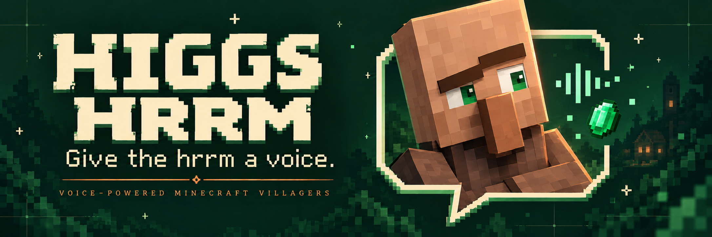
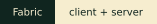
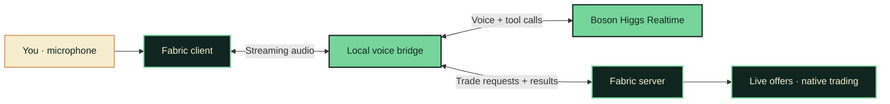

<p align="center">
  
</p>

<p align="center">
  <strong>Your favorite village has something to say.</strong><br />
  Voice conversations with Minecraft villagers, connected to their real trades.
</p>

<p align="center">
  <a href="docs/setup.md"><strong>Get started</strong></a> &nbsp;·&nbsp;
  <a href="demo.md">Demo &amp; presentation</a> &nbsp;·&nbsp;
  <a href="docs/architecture.md">Architecture</a> &nbsp;·&nbsp;
  <a href="backend/README.md">Voice bridge</a>
</p>

<p align="center">
  
  
  
  
</p>

---

## Less hrrm. More hello.

Villagers have professions, stock, and a place in your world. Now you can ask them about it.

**HIGGS HRRM** gives Minecraft villagers a voice through Boson Higgs Realtime. Walk up, start a conversation, ask what is available, and request a trade. The mod connects the conversation to live offers and completes a native trade after one spoken confirmation.

<table>
  <tr>
    <td width="33%" valign="top">
      <h3>01 &nbsp; Meet</h3>
      <p>Look at a nearby villager and press <kbd>V</kbd>. Wait for <strong>Ready</strong>.</p>
    </td>
    <td width="33%" valign="top">
      <h3>02 &nbsp; Speak</h3>
      <p>Hold <kbd>B</kbd>, say what is on your mind, then release to hear the reply.</p>
    </td>
    <td width="33%" valign="top">
      <h3>03 &nbsp; Trade</h3>
      <p>Ask for an available offer. Hear the quote and say yes to confirm.</p>
    </td>
  </tr>
</table>

## The conversation

Try these prompts with a villager. Responses are generated live; available items depend on its actual offers.

> **Say hello** &nbsp; “What do you do around here?”
>
> **Explore the shop** &nbsp; “What can I buy from you?”
>
> **Make a request** &nbsp; “I would like…” — name an available item it mentioned.

The villager reads the exact quote. Say yes in a new push-to-talk turn to complete one trade, without opening a screen.

## A voice with a connection to the world

| | What happens |
| :--- | :--- |
| **In-character conversation** | Villager name, profession, and level give the conversation context. |
| **Live offer lookup** | `get_trades` reads current offers from the Minecraft server. |
| **An action you can see** | `propose_trade` checks availability and proximity, then opens native trading. |
| **Room to interrupt** | Hold **B** during a reply to interrupt and begin your next turn. |
| **Player-controlled purchases** | Minecraft handles the exchange and final prices; voice does not spend your items. |

## Under the hood



We build the mod, audio capture and playback, local bridge, session handling, and game tools. Higgs powers voice and tool-call generation. Minecraft owns the offers, inventory, and actual transaction.

## Bring your village to life

You will need **Minecraft Java 26.1.2**, a matching **Fabric client**, **JDK 25**, **Node.js 22+**, and a **Boson API key**. Install the mod on both client and server. The bridge runs locally alongside the game server.

**[Follow the complete setup guide →](docs/setup.md)**

Already have the local installation configured? Start the bridge and server in separate terminals:

```sh
npm --prefix backend start
```

```sh
./server-cardboard/start.command
```

Join `localhost:25565`, face an adult, awake villager within eight blocks, and wait for the automatic voice connection. [Installation, credentials, microphone permission, and troubleshooting](docs/setup.md#villager-voice-prototype) are covered in the setup guide.

| Key | Action |
| :--- | :--- |
| **Look at a villager** | Connect automatically; look at another and press B to switch |
| **Hold B → release** | Speak, then send your turn |
| **F8** | Show or hide voice diagnostics |

## On the workbench

This is a hackathon prototype. The voice bridge, Fabric integration, and trade tools are implemented. Full microphone, playback, and in-game trade validation still need confirmation on the target setup; local mock tests and synthetic voice probes cover only part of that path.

Current scope: push-to-talk in the game client, system audio for the speaking player, and conversation history within a session. Negotiated prices and bounded per-villager relationship scores are implemented. Persistent conversation memory and spatial or shared audio are future directions.

<details>
<summary><strong>Development checks</strong></summary>

```sh
npm --prefix backend test
./scripts/build-mod.sh
```

Backend tests use a local fake Higgs endpoint. The build compiles the mod; neither check establishes a successful live conversation. See the [bridge notes](backend/README.md) for investigation evidence.

</details>

## Explore the project

| Path | Inside |
| :--- | :--- |
| [`mod/`](mod/) | Fabric client and server; microphone, playback, sessions, and trades |
| [`backend/`](backend/) | Local Higgs voice bridge and tool routing |
| [`docs/architecture.md`](docs/architecture.md) | System boundaries and the end-to-end interaction |
| [`docs/setup.md`](docs/setup.md) | Full installation, controls, local server, and troubleshooting |
| [`demo.md`](demo.md) | Presentation script, demo flow, and rehearsal checklist |
| [`docs/brand.md`](docs/brand.md) | Logo, colors, and artwork notes |

---

<p align="center">
  <br />
  <strong>Give the hrrm a voice.</strong><br />
  <sub>Built with Fabric · Powered by Boson Higgs Realtime</sub><br />
  <sub>Unofficial Minecraft project. Banner artwork is illustrative, not a gameplay screenshot.</sub>
</p>

Captions for YOU and VILLAGER remain for eight seconds, then fade over three. Your transcript arrives after speech processing. The microphone HUD stays visible during conversations; F8 toggles additional diagnostics.

Successful voice trades show a gentle handoff: cosmetic payment items float toward the villager, then the purchased item floats back. A soft chime and a fading receipt confirm the exchange. These client-only copies never become dropped items or affect inventory.

## Voice negotiation

Ask for an item, a quantity, a budget, or a better deal: “I only have two emeralds,”
“Could I get fifteen bread for four emeralds?” or “Could you give me a better price, please?”
The server quotes exact whole-item amounts; say yes in a new turn to buy. A changed
or counteroffered bundle always needs a fresh yes.

Prices are relative to the native player-specific default trade: friendly 80–100%,
neutral 95–110%, annoyed 110–125%. Explicit politeness and insults affect mood;
bargaining or declining alone is neutral. Relationship scores persist per player
and villager in the world data folder, are capped at -5 to +5, and change at most
once per minute. Existing Minecraft reputation also matters. Higgs classifies the
utterance, while the server enforces every limit. Quotes remain valid for two minutes.

Bundles are limited to one stack per item (at most 64); secondary payments scale
proportionally, rounding up to whole items. Unrepresentable prices receive a nearby
valid counteroffer. Larger quantities consume proportional stock, rounded up to
native trade uses; small purchases still use one stock unit. The native inventory
transaction handles item components, space, trade statistics and rewards. Price
negotiation cannot bypass missing payment, stock, proximity or inventory checks.

A compact, non-interactive trade tracker shows the villager and the current server quote: YOU GIVE, YOU GET, and “Say yes to accept.” Revised amounts briefly show the previous deal crossed out. Expired or cancelled offers stop inviting acceptance, and success or failure fades after six seconds. Switching villagers clears the tracker; all choices still use voice.

Repeated quotes with identical terms retain the original proposal ID, confirmation turn, and expiry. A repeated confirmation returns the existing purchase receipt without buying again. Trade diagnostics log tool names, turn numbers, and outcomes without speech content.
