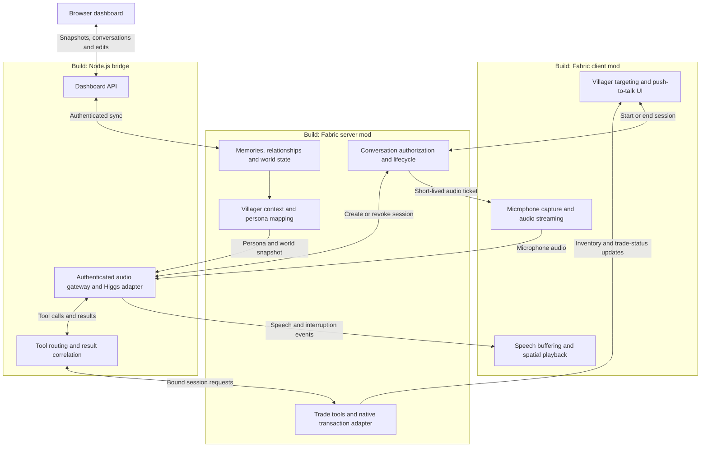

# HIGGS HRRM · Architecture

[← HIGGS HRRM](../README.md) · [Visual identity](brand.md)

The implementation lives in `mod/` and `backend/`. It includes push-to-talk voice,
validated game tools, persistent personalities and memories, gossip, companion
conversations, and a local browser dashboard. The diagram below summarizes the
runtime boundaries; [gameplay reference](gameplay.md) describes the full feature set.

Live mono PCM streams through Minecraft’s sound engine, following the villager with
native distance attenuation and Friendly Creatures volume control. A client-only
mixin supplies the live stream. The bridge compiles character directions from saved
profiles and selects a configured voice. [Personality implementation](villager-personalities.md).
The Minecraft client sends microphone audio while **B** is held and commits the turn
on release; pressing B during a reply interrupts it. Sessions have a ten-minute limit.
The bridge also supports hands-free VAD clients, but Minecraft uses push-to-talk.

Target Minecraft 26.1.2 and Fabric. Install the same mod on client and server, with
client-only audio code kept out of the dedicated server entry point. Run the Node.js
bridge alongside the server; it also serves the dashboard. See [setup](setup.md) for
installation and [the playtest checklist](playtest-checklist.md) for target-machine
verification. Automated checks and the recorded demo do not establish that every
feature has been tested on every setup.

## What we build

Every box below represents custom project work. The groups are runtime boundaries;
the boxes inside them are modules, not separate services.

## Responsibilities and boundaries

| Component | Custom work |
| --- | --- |
| Client interaction UI | Target a nearby villager, connect automatically, and show conversation, microphone, captions, and trade state. Hold B to speak and release to send; walk away to end the session. Hostile villagers refuse voice and vanilla trades. |
| Microphone capture | Request OS microphone access, capture and convert audio to the API format, send bounded chunks over a dedicated WebSocket only while B is held in the focused game window, and stop capture when the session ends. Audio does not pass through Minecraft's game packets. |
| Speech playback | Decode and buffer returned audio, play it from the selected villager's location through the client audio facilities, and flush queued speech on interruption or session cancellation. Direct conversation replies play for the speaking player; ambient chatter and event reactions have separate nearby-listener playback. |
| Conversation lifecycle | Validate the player and villager on the game server, enforce distance and one active conversation per player, and bind player UUID, villager UUID, and session ID. End the session on walking away, disconnect, death, or villager removal. Issue short-lived, single-use tickets for the matching audio session. |
| Villager context | Read profession, existing offers, and relevant world facts from Minecraft. Supply a configurable personality and voice selection keyed by villager UUID. Refresh trade facts through tools rather than trusting an old prompt snapshot. |
| Trade handlers | Implement live lookup, previews, bounded negotiation, proposals, confirmation, and cancellation for the bound villager. Quote exact bundles and require a fresh spoken yes before a native server-side exchange. Validate offer identifiers, input turns, stock, payment, and session eligibility on the game thread. Return the actual result to Higgs. |
| Higgs adapter | Keep the Boson API key on the backend, establish a Higgs Realtime session, supply persona/context/tool definitions, relay audio and events, and handle cancellation, timeouts, bounded buffering, and disconnect cleanup. |
| Tool router | Validate tool names and arguments, forward requests over an authenticated server-mod/backend connection, and return results correlated with the Higgs call ID. Deduplicate repeated calls within a session; never trust a model-supplied player or villager identity. |

The backend and server mod share a local credential. The client receives only
the short-lived audio ticket, never that credential or the Boson API key.
Bind backend endpoints to loopback for local development. Before remote use,
add TLS and explicit network configuration for the authenticated connections.

## Existing capabilities we reuse

These are dependencies, deliberately omitted from the build diagram:

- **Minecraft:** world generation, villager entities and AI, professions, offers,
  inventory, emeralds, merchant screen, player authentication, and world saving.
- **Minecraft's trading implementation:** validates and performs the actual
  inventory exchange, offer usage, and experience updates. Voice trades invoke
  the server-side transaction path after confirmation without opening the merchant screen.
- **Fabric:** mod loading, lifecycle hooks, and client/server payload support.
- **Higgs Realtime:** speech understanding and generation, conversational model,
  turn detection, interruption events, and tool-call generation. We implement
  the application-side audio handling and tools, not separate speech models.
- **Cardboard:** stays in the current server installation for plugin support,
  but our native Fabric mod does not depend on the Bukkit compatibility layer.

Boson's [Realtime tutorial](https://www.boson.ai/blog/higgs-realtime-tutorial)
describes streaming audio, interruption handling, and executing tool calls.
Its [API documentation](https://docs.boson.ai/) is the source for exact event
schemas, audio formats, and session configuration. The current application configuration
lives in [`backend/lib/protocol.js`](../backend/lib/protocol.js).

## One conversation, end to end

1. The player targets a villager and starts talking. The server checks proximity
   and creates a conversation bound to that player and villager.
2. The backend creates the Higgs session using the server-provided persona and
   context. The client authenticates its audio connection with its session ticket.
3. Holding B interrupts current playback and streams microphone audio to the bridge
   and then Higgs. Releasing B commits the turn. The bridge retrieves relevant memories
   before requesting the reply, which streams back into the client's playback buffer.
4. For “What can I buy?”, Higgs calls `get_trades`. The server mod reads the
   villager's current offers and returns them through the backend.
5. For “I'd like that bread trade”, Higgs calls `propose_trade` with an offer identifier
   and optional bounded quantity, budget, or discount request. The server returns
   the exact bundle, costs, and a proposal ID, without opening a screen.
6. A fresh explicit spoken yes leads to `confirm_trade`. The server checks the
   proposal, trusted input turn, availability, price, stock, payment, and inventory,
   then executes one native server-side exchange. Only a successful receipt may
   be reported as purchased. Declines cancel the proposal. Model interpretation
   supplies consent intent; server validation enforces the transaction boundary.
7. Ending the conversation or losing eligibility revokes the session and stops
   microphone capture, playback, and pending tool requests.

## Current scope

Voice-confirmed trading, haggling, quests, gifts, errands, walks and directions are
implemented alongside persistent memory and relationships. A nearby companion can
join a conversation; separate ambient chatter lets villagers speak to each other.
See [gameplay](gameplay.md) for behavior and limits. Persistence uses world-scoped
files; no database service is needed.

The [dashboard](../README.md#village-dashboard) is served by the same bridge. It
requires a separate dashboard token and local access. The game server syncs every
three seconds and builds full snapshots while the page is watched. The browser
shows loaded villagers, village maps, players, relationships, and live conversation
context. Validated edits are queued by the bridge and applied by the game server.

## Persistent memory and nearby gossip

`VillagerMemoryStore` keeps bounded summaries keyed by villager and player UUID in
`<world>/data/higgs_hrrm_memories.json`. It writes ordered snapshots on a background
writer and exposes memories for recall and gossip after a successful save. The
`remember_conversation` tool and internal `_recall_turn` read reuse the authenticated game-tool
route; the server binds identities rather than accepting UUIDs from the model. Recall
uses BM25 over authorized records, with gossip interest only a tie-breaker.
Memory summaries are attributed player claims, not observed world facts.

`VillagerMemoryService` adds a bounded mix of recent personal and salient public memories to session context,
handles fresh recall, and samples loaded villagers for proximity-based transfers.
`VillagerGossip` enforces eligibility, dimension, distance, pair cooldowns, and root
deduplication. A pass uses a snapshot so newly heard stories cannot cascade in the
same pass. Private entries and exhausted hop counts cannot spread. A successful
save triggers native green particles above the participants. Visible gossip visits
can use short whispered Higgs turns when chatter is enabled and a player is nearby;
a silent visual exchange remains available when voice cannot play. See the [feature guide](memory-rumours.md) for limits,
configuration, failure behaviour, and live rehearsal steps.

For PTT, the bridge matches a committed audio item to its transcript, reads relevant
memories, then inserts attributed context before requesting speech. Recall is not a
speaker tool, and spoken text is never filtered. Context updates preserve the original
conversation and are explicitly not player speech or consent. See the
[Sapience comparison and measured results](memory-evaluation.md) for provider constraints,
benchmarks, timeout behavior, and the VAD limitation.

### Automatic story selection and conversation openings

The voice model assesses the meaning of notable statements during normal speech and supplies an interest score, reason, and audience professions to the memory tool. Public stories above the threshold qualify for gossip. The server ranks candidates by interest, recipient profession, freshness, and hop count. Low-interest preferences remain useful memories without becoming rumours. Existing schema-1 and schema-2 stores migrate to schema 3 with their identities and privacy flags preserved; schema 3 records when each holder learned a story.

Session context includes ranked heard rumours and a fresh opening topic when available. `RumourConversation` limits repeated opening topics per player/villager/story. Once the configured provider session is confirmed, the bridge requests an initial response so the villager can greet the player and react to its selected story without requiring a spoken prompt. Relevance and freshness guide the opener; the model chooses the wording. The existing player interruption path remains active.
