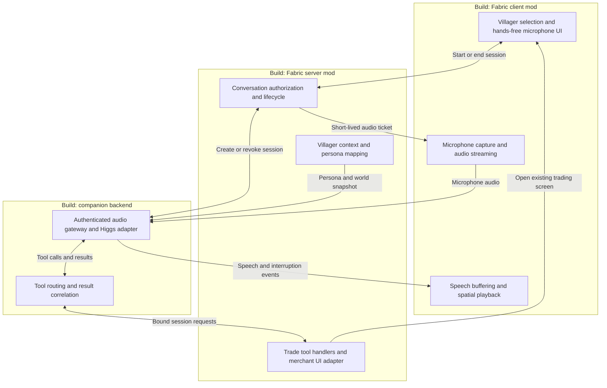

# HIGGS HRRM · Architecture

[← HIGGS HRRM](../README.md) · [Visual identity](brand.md)

**Status: voice/trade prototype plus persistent memory and local gossip implemented; full live in-game validation pending.**
The code is in `mod/` and `backend/`. The diagram remains the target architecture.
The prototype uses default system audio rather than spatial playback; persona
comes from a shared prompt plus villager context rather than persistent per-villager
voice configuration. It uses a ten-minute session limit; hands-free sessions use
Higgs server-side voice activity detection. The live API accepts this configuration;
end-to-end microphone and in-game trade validation still need the Fabric client.
See the [setup guide](setup.md) for installation and controls.

Target Minecraft 26.1.2 and Fabric. Install our mod on both the client and server,
with client-only audio code kept out of the dedicated server entry point.
Run one companion backend process locally for the first version.

## What we build

Every box below represents custom project work. The three groups are runtime boundaries;
the boxes inside them are modules, not separate services.

## Responsibilities and boundaries

| Component | Custom work |
| --- | --- |
| Client interaction UI | Select a nearby villager, request a conversation, show listening/speaking/error state, and provide mute and end-conversation controls. Keep normal villager trading available. |
| Microphone capture | Request OS microphone access, capture and convert audio to the API format, send bounded chunks over a dedicated WebSocket, and stop capture when the session ends. Audio does not pass through Minecraft's game packets. |
| Speech playback | Decode and buffer returned audio, play it from the selected villager's location through the client audio facilities, and flush queued speech on interruption or session cancellation. Initially only the speaking player hears the response. |
| Conversation lifecycle | Validate the player and villager on the game server, enforce distance and one active conversation per player, and bind player UUID, villager UUID, and session ID. End the session on walking away, disconnect, death, or villager removal. Issue short-lived, single-use tickets for the matching audio session. |
| Villager context | Read profession, existing offers, and relevant world facts from Minecraft. Supply a configurable personality and voice selection keyed by villager UUID. Refresh trade facts through tools rather than trusting an old prompt snapshot. |
| Trade handlers | Implement `get_trades` and `propose_trade` for the bound villager. Validate offer identifiers and session eligibility on the game thread; open the existing merchant screen for an eligible proposal. Return success or failure to Higgs. |
| Higgs adapter | Keep the Boson API key on the backend, establish a Higgs Realtime session, supply persona/context/tool definitions, relay audio and events, and handle cancellation, timeouts, bounded buffering, and disconnect cleanup. |
| Tool router | Validate tool names and arguments, forward requests over an authenticated server-mod/backend connection, and return results correlated with the Higgs call ID. Deduplicate repeated calls within a session; never trust a model-supplied player or villager identity. |

The backend and server mod share a local credential. The client receives only
the short-lived audio ticket, never that credential or the Boson API key.
Bind backend endpoints to loopback for local development. Before remote use,
add TLS and explicit network configuration for the authenticated connections.

## Existing capabilities we reuse

These are dependencies, deliberately omitted from the build diagram:

- **Minecraft:** world generation, villager entities and AI, professions, offers,
  inventory, emeralds, merchant screen, player authentication, and world saving.
- **Minecraft's trading implementation:** validates and performs the actual
  exchange when the player takes the result in the merchant screen, including
  normal offer usage and experience updates. We do not build a second economy.
- **Fabric:** mod loading, lifecycle hooks, and client/server payload support.
- **Higgs Realtime:** speech understanding and generation, conversational model,
  turn detection, interruption events, and tool-call generation. We implement
  the application-side audio handling and tools, not separate speech models.
- **Cardboard:** stays in the current server installation for plugin support,
  but our native Fabric mod does not depend on the Bukkit compatibility layer.

Boson's [Realtime tutorial](https://www.boson.ai/blog/higgs-realtime-tutorial)
describes streaming audio, interruption handling, and executing tool calls.
Its [API documentation](https://docs.boson.ai/) is the source for exact event
schemas, audio formats, and session configuration when implementation begins.

## One conversation, end to end

1. The player targets a villager and starts talking. The server checks proximity
   and creates a conversation bound to that player and villager.
2. The backend creates the Higgs session using the server-provided persona and
   context. The client authenticates its audio connection with its session ticket.
3. An active, unmuted session streams microphone audio to the backend and then Higgs. Spoken
   replies stream back into the client's playback buffer.
4. For “What can I buy?”, Higgs calls `get_trades`. The server mod reads the
   villager's current offers and returns them through the backend.
5. For “I'd like that bread trade”, Higgs calls `propose_trade` with an offer
   identifier. The server mod rechecks the session and offer and opens the
   existing merchant screen. This is a proposal, not a purchase.
6. The player completes the trade in Minecraft's screen. Vanilla trading remains
   authoritative. If we want spoken purchase confirmation, add a server-side
   observer of completed trades and send that verified result to the session;
   opening the screen alone must never be reported as a completed purchase.
7. Ending the conversation or losing eligibility revokes the session and stops
   microphone capture, playback, and pending tool requests.

## First implementation scope

Build voice-only conversation with one nearby villager first, then add live
offer lookup and merchant-screen handoff. Test permission denial, interrupted
speech, invalid offers, moving out of range, and disconnects before expanding.

The first version uses existing trades and per-session voice conversation history.
Persistent conversation summaries now live in a separate world-scoped memory store.
Negotiated prices, voice-only purchase confirmation, and speech audible to nearby
players remain later features. No database service is needed.

## Persistent memory and nearby gossip

`VillagerMemoryStore` keeps bounded summaries keyed by villager and player UUID in
`<world>/data/higgs_hrrm_memories.json`. It writes ordered snapshots on a background
writer and exposes memories for recall and gossip after a successful save. The
`remember_conversation` and `recall_memories` tools reuse the authenticated game-tool
route; the server binds identities rather than accepting UUIDs from the model.
Memory summaries are attributed player claims, not observed world facts.

`VillagerMemoryService` adds the current player's saved memories to session context,
handles fresh recall, and samples loaded villagers for proximity-based transfers.
`VillagerGossip` enforces eligibility, dimension, distance, pair cooldowns, and root
deduplication. A pass uses a snapshot so newly heard stories cannot cascade in the
same pass. Private entries and exhausted hop counts cannot spread. A successful
save triggers native green particles above the participants; there is no autonomous
villager voice session. See the [feature guide](memory-rumours.md) for limits,
configuration, failure behaviour, and live rehearsal steps.
