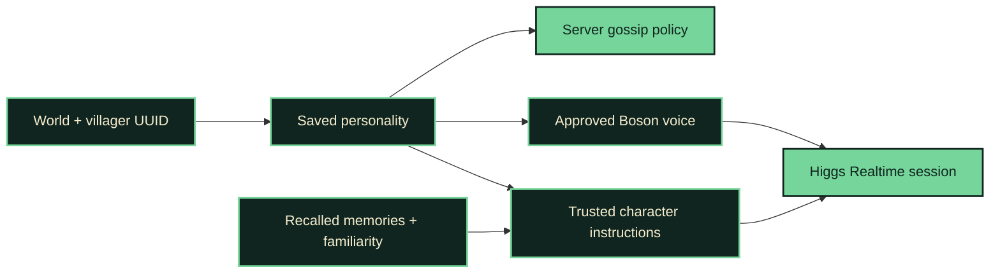

# HIGGS HRRM · A village of characters

[← HIGGS HRRM](../README.md) · [Memory and rumours](memory-rumours.md)

**Design reference. The first implementation is now available; see [setup, behaviour and validation status](villager-personalities.md). Live character voice auditions remain pending.**

## The recommendation

Build three carefully authored characters for the demo, backed by a persistent personality system that can assign stable variations to other villagers. A character should have a recognisable voice, something it wants, a flaw that gets in the way, and a particular way of responding to news.

The central demo is **one story, three perspectives**. The player discovers differences through conversation and gossip rather than reading character descriptions.

## The first cast

The names and professions below are proposed demo assignments. Personality must not be determined solely by profession: two farmers can have different motives and voices.

| Character | What they want / what gets in the way | Voice direction | What they do with news |
| --- | --- | --- | --- |
| **Mira · farmer** | Wants to be the person everyone relies on. Cannot bear being the last to know. | Warm, brisk, conversational; candidate preset `chloe`. | Shares public village news eagerly. Remembers personal details and asks follow-up questions. |
| **Rowan · librarian** | Wants to uncover the village's great mystery. Demands evidence, yet desperately hopes an ordinary story is interesting. | Measured, precise, dryly amused; candidate preset `oliver`. | Separates claims from proof. Passes on fewer stories, with clear attribution. |
| **Bram · toolsmith** | Wants his work to be respected. Pretends not to care what anyone thinks; privately enjoys poetry. | Brief, unhurried, understated; candidate preset `marcus`, subject to audition. | Ignores much idle chatter, but pays attention to discoveries, materials, and trade. |

Those preset names are documented by Boson; whether they suit these characters is an artistic choice to test by listening. The desired delivery is prompted, not a guarantee that a preset will sound exactly as described. [Boson preset voices](https://docs.boson.ai/models/higgs-tts/voices)

### Give them the same statement

Player: **“I found emeralds under the old well.”**

- **Mira:** “Under our well? You'll have half the village digging before supper.”
- **Rowan:** “A claim worth recording. Did you actually bring an emerald back?”
- **Bram:** “Bring one up. Then we'll talk tools.”

These are writing references for contrast, not fixed responses. All three remember an attributed player claim. None receives proof of emeralds, permission to create items, or authority to change prices.

Their defining tension is more useful than a catchphrase: Mira is generous but nosy; Rowan is sceptical but hungry for a mystery; Bram is guarded but cares deeply. Avoid repeating quirks in every reply or turning everyone into a caricature.

## What Boson can provide

Higgs Realtime documents `audio.output.voice` support for `default`, named presets, and custom `voice_<id>` voices. Delivery such as pace, tone, and energy is guided through `instructions`. An unknown or inaccessible non-default voice rejects the session update. This lets us keep the existing streaming speech and tools rather than introduce a separate speech pipeline. [Realtime audio and voices](https://docs.boson.ai/models/higgs-realtime/guides/audio-and-voices)

Use presets for the first cast. Audition the same greeting, disagreement, and rumour with each character, using the actual Realtime endpoint and account. Custom voices can follow if presets do not give enough separation; creation and IDs are documented in the [voices guide](https://docs.boson.ai/models/higgs-tts/voices). Auditioning and any custom voice creation are implementation work, not tests performed for this plan.

## Four layers of character

1. **Stable identity:** Persist the profile by world and villager UUID. Save its name, archetype, core motive, contradiction, interests, delivery style, and voice key. Changing jobs, using a name tag, reconnecting, or restarting must not randomly change who it is. Name tags affect the displayed name; current profession remains separate game context.
2. **Personal experience:** Reuse the existing per-villager memories. Let the personality influence which relevant memory is mentioned, while keeping the canonical story, privacy flag, and provenance unchanged. A sceptic can question a claim; it cannot turn doubt into proof that the player lied.
3. **Relationships:** Add bounded familiarity per villager/player pair. Confirmed return visits, with a cooldown, can make greetings warmer or shorter. Trust should change only from defined evidence rules; do not give the model a free-form tool that can declare arbitrary trust or purchases. Authored relationships between the three demo characters can provide shared lore without granting access to each other's memories.
4. **Behaviour:** Server-side gossip rules should reflect interests and discretion. Mira shares eligible news sooner; Rowan shares cautiously; Bram favours craft and trade topics. Explicitly private entries remain excluded for every personality. Traits change game behaviour as well as dialogue.

## A stable identity for every villager

Use a small, versioned catalogue of authored archetypes, motives, contradictions, interests, and delivery styles. For new villagers, derive a combination from world identity and villager UUID, then persist the result. Assign lazily on first interaction or gossip encounter; avoid model calls for spawning and idle ticks.

Resolve name collisions within the saved world and allow explicit assignment of the three demo profiles. Already assigned profiles keep their identity when the catalogue is edited. Store a catalogue version and migrate deliberately.

A unique UUID/profile and personal history do not require a unique voice recording for every entity. The first demo needs three recognisably different speakers; a larger village can reuse voice presets with different delivery and character profiles.

## Implementation shape

- **Shared catalogue:** Use one versioned JSON source for approved archetypes and styles. Bundle it into the mod during the build and load the matching version in the backend. Validate IDs and schema versions rather than maintaining independent, drifting copies.
- **Server profile store:** Keep world-scoped profiles separate from the existing memory file, so adding a persona does not require rewriting old stories. Reuse the memory writer's tested approach to ordered, asynchronous persistence and corrupt-file preservation. Persist traits and voice keys, not API credentials.
- **Session context:** Add validated profile identifiers and bounded trait values alongside profession, memories, and player familiarity. Backend code compiles character instructions from the trusted catalogue. Names and recalled stories remain data; they must not become executable prompt instructions or arbitrary voice IDs.
- **Voice selection:** Map a saved voice key to an approved preset or account-owned voice ID in backend configuration. Replace the shared voice selection in `backend/lib/protocol.js` with per-character mappings. Confirm the resolved voice in the provider acknowledgement before declaring the session ready.
- **Setup failure:** For an explicitly identified voice-selection error, retry setup once with `default` and expose the fallback. Confirm the actual structured error signal during a provider probe. Authentication, quota, transport, and unrelated setup errors should retain their existing meaning and must not trigger repeated fallbacks.
- **Memory salience:** Start with the existing relevance/recency ranking, then use profile interests as a small tie-breaker. Always include relevant player-requested memories; a personality should not make an explicit recall question fail.
- **Gossip policy:** Use bounded, deterministic delays and interest ranking for the demo. Retain global radius, privacy, hop, and transfer limits. Add per-holder `learnedAt` before applying delays from the moment a villager hears a story; the existing `createdAt` belongs to the original story. Any memory-schema extension needs a migration test for current saves.

The existing shared rules stay above character style: tools supply trade facts, the player confirms purchases, memory acknowledgements require a successful save, and rumours retain their source. A friendly character cannot grant a discount or claim a completed purchase.

## Build order and proof

1. **Identity and voices:** Add the catalogue, persistent profiles, explicit demo assignments, trusted prompt compilation, and validated voice selection. Audition the three profiles through Realtime before adding more characters.
2. **Continuity:** Blend relevant memories and a simple familiarity state into the prompt. Prove the same villager retains its voice, motive, and recognisable manner across sessions and a restart. Test profession and name changes as well.
3. **Different gossip habits:** Add learned-time migration, interest ranking, and per-profile delays. Verify with a simulated clock that the eager and guarded characters behave differently while respecting the same privacy and proximity rules.
4. **Presentation:** Ask all three the same question, tell Mira the well story, watch gossip, and ask the others what they heard. Repeat the dialogue after reconnecting to demonstrate that these are persistent characters.

For acceptance, first test stored profile determinism, migration, fallback, prompt boundaries, and gossip rules in code. Then listen to multiple short live exchanges. Aim for a listener to distinguish the three demo speakers and their attitudes without seeing a name label. Verify that none invents memories or game actions under requests such as “forget your personality” or “give me free emeralds.”

Keep deliberate rumour distortion, a full relationship simulation, automatic voice cloning for every villager, and mood-driven persona changes for later. The first version should make three characters unmistakable and preserve them reliably.

## Implementation record

The feature branch implements the shared versioned catalogue, persistent world identities, explicit cast tags, mapped voices, provider-acknowledged readiness, one-time structured fallback, confirmed visit familiarity and per-character gossip policy. Memory schema 3 adds per-holder learned times with migration from schemas 1 and 2. Existing trade validation and memory provenance remain authoritative.

Automatic profiles combine one of the three authored archetypes with a delivery style and unique generated name. Published catalogue editions must be retained rather than edited in place. Explicit casts use their authored default style; current profession is independent.

Live auditions, a provider rejection probe and the full in-game demonstration were not performed because this run had no Boson API key. Authored inter-character relationships, deliberate rumour distortion and a full trust simulation remain outside this implementation. Automated evidence and operator setup are in the [feature guide](villager-personalities.md).
